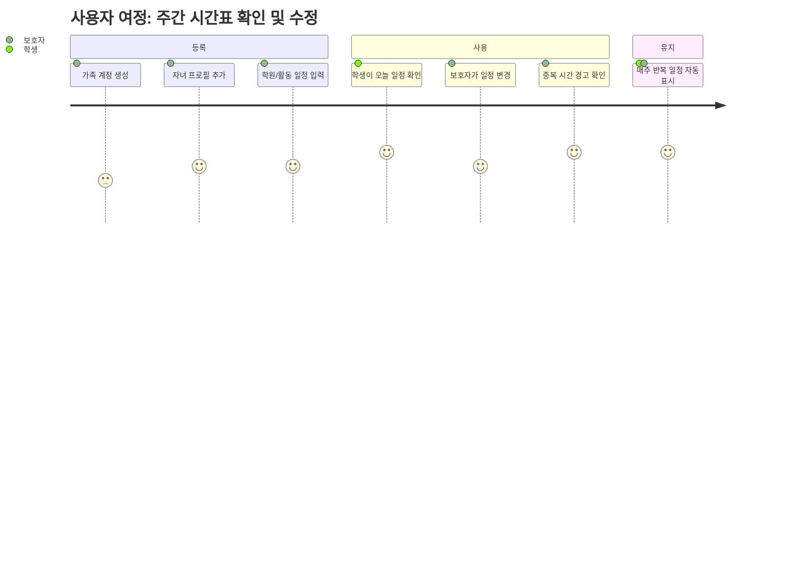
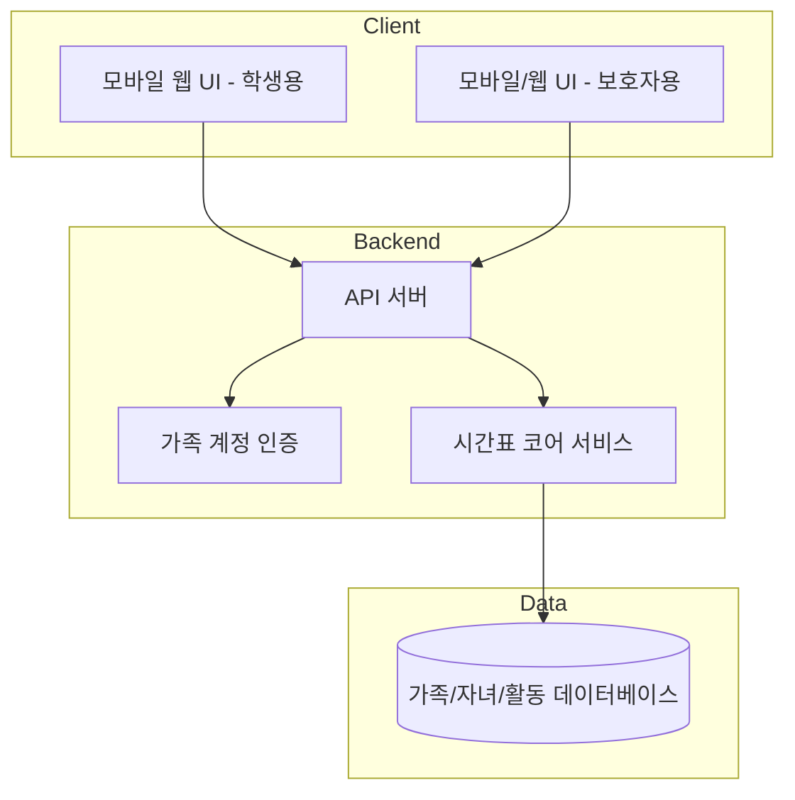
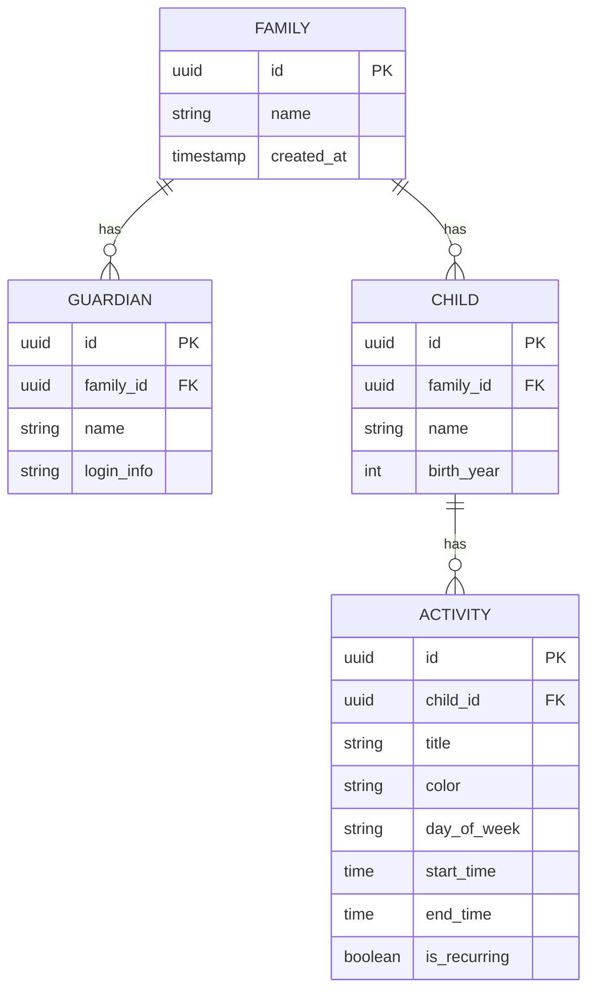
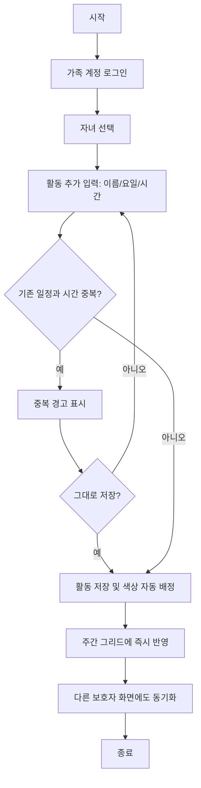
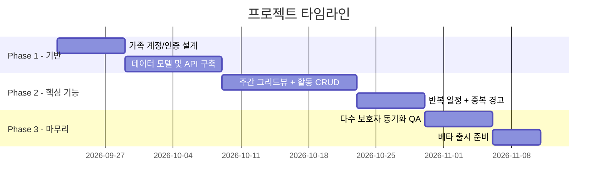

# 아이 활동 시간표 (Kids Activity Schedule)

> **Version**: 1.0.0
> **Status**: Draft
> **Created**: 2026-09-15
> **Last Updated**: 2026-09-15
> **Author**: djmskim86

---

## Executive Summary

"아이 활동 시간표"는 한 아이(또는 여러 형제자매)가 다니는 여러 학원·방과후 활동(태권도, 미술, 구몬, 필즈 등)을 요일별 그리드 위에 색깔로 구분해 한눈에 모아 보여주는 개인/가정용 통합 시간표 서비스다. 현재 많은 가정이 종이나 화이트보드에 손으로 시간표를 적어 벽에 붙여두고 있으며, 이 과정에서 시간 충돌과 기입 실수가 반복적으로 발생한다. 이 서비스는 학생 본인과 여러 보호자가 함께 조회·수정할 수 있는 디지털 시간표를 제공해, 종이 시간표를 대체하고 일정 충돌을 자동으로 방지하는 것을 목표로 한다.

---

## 1. Problem Statement

### The Problem

아이 한 명이 여러 학원·활동(학습지, 예체능, 스포츠 등)을 병행하는 경우, 요일마다 다른 시간대에 서로 다른 기관의 수업이 배치된다. 이를 종이나 화이트보드에 수기로 정리하다 보면 시간이 겹치거나(중복 신청) 기입을 빠뜨리는 실수가 반복적으로 발생한다.

### Who Has This Problem

- 여러 학원·방과후 활동을 다니는 초등 저학년(8~10세) 자녀를 둔 가정
- 특히 형제자매가 있어 여러 명의 일정을 동시에 관리해야 하는 부모
- 맞벌이 등으로 여러 보호자(부모, 조부모 등)가 나눠서 아이를 픽업·등원시켜야 해 일정 공유가 필요한 가정

### Current Solutions & Workarounds

- 종이 출력물 또는 손글씨 표를 벽/방문에 테이프로 부착 (참고 이미지 사례)
- 엑셀/스프레드시트로 별도 작성 후 출력 또는 캡처 공유
- 여러 학원 각각의 알림톡·문자를 따로 확인

기존 방식은 한 곳에서 전체 일정을 통합해서 보여주지 못하고, 변경 시 수기로 다시 작성해야 하며, 여러 보호자 간 실시간 동기화가 되지 않는다는 한계가 있다.

### Why Now

시간 충돌·실수가 반복되고 있어 지금 이 문제를 해결하고자 하는 니즈가 확인되었으며, 참고 사례(첨부 이미지)처럼 이미 자체적으로 종이 시간표를 만들어 쓰고 있을 만큼 수요가 구체적이다.

---

## 2. Users & Personas

### Primary User: 초등 저학년 학생

| Attribute | Description |
|-----------|-------------|
| Role | 시간표의 주 사용자 (8~10세, 초등 저학년) |
| Technical Level | Non-technical (보호자의 초기 설정 지원 필요) |
| Primary Goal | 본인 기기로 오늘/이번 주 어떤 활동이 있는지 직접 확인 |
| Pain Points | 종이 시간표를 매번 확인해야 하고, 변경 사항을 놓치기 쉬움 |
| Success Criteria | 앱만 보면 헷갈리지 않고 바로 오늘 일정을 알 수 있음 |

### Secondary Users: 보호자(부모 등 다수)

| Attribute | Description |
|-----------|-------------|
| Role | 일정 입력·수정 및 조회 |
| Technical Level | Basic |
| Primary Goal | 여러 학원 일정을 한 곳에 모아 충돌 없이 관리 |
| Pain Points | 배우자/다른 보호자와 최신 일정을 공유하기 어려움 |
| Success Criteria | 한 명이 수정하면 다른 보호자도 즉시 같은 화면을 봄 |

### User Journey

---

## 3. Solution Overview

### High-Level Approach

요일(월~금 등) × 시간대로 구성된 주간 그리드 뷰에, 학원/활동별로 자동 배정된 색상 블록을 배치해 한 아이의 모든 활동을 한 화면에서 보여준다. 보호자는 활동을 추가·수정·삭제할 수 있고, 반복되는 주간 일정은 한 번만 설정하면 자동으로 매주 표시된다. 같은 시간대에 활동이 겹치면 시스템이 자동으로 경고해 종이 시간표에서 반복되던 충돌 문제를 방지한다.

### Key Differentiators

- 하나의 학원이 아닌, **여러 기관의 활동을 아이 기준으로 통합**해서 보여줌
- 활동 추가 시 **자동 색상 배정**으로 종이 시간표 특유의 시각적 구분을 그대로 재현
- **다수 보호자 동시 접근**을 전제로 설계 (한 사람만 관리하는 구조가 아님)
- **시간 중복 자동 감지**로 손으로 대조하지 않아도 충돌을 파악

### Success Metrics

| Metric | Target | Measurement Method |
|--------|--------|-------------------|
| 종이 시간표 대체율 | 기존 종이/화이트보드 사용 중단 | 사용자 인터뷰/설문 |
| 시간 충돌 발생 건수 | 등록 후 충돌 재발 0건 | 앱 내 충돌 경고 로그 |
| 주간 활성 사용(WAU) | 등록 가정의 주 1회 이상 조회 | 접속 로그 |

---

## 4. Features & Requirements

### MVP Features (P0 - Must Have)

#### Feature 1: 주간 그리드뷰

**Description**: 요일(가로) × 시간대(세로) 그리드에 자녀의 모든 활동을 색상 블록으로 표시한다.

**User Story**: 학생으로서, 본인 기기로 오늘 무슨 활동이 있는지 한눈에 보고 싶다.

**Acceptance Criteria**:
- [ ] 월~금(및 필요 시 주말) 요일별 열과 시간대별 행으로 구성된 그리드를 표시한다
- [ ] 각 활동은 참고 이미지처럼 배정된 색상 블록으로 표시된다
- [ ] 모바일 화면 폭에서도 가로 스크롤 없이 읽을 수 있어야 한다

**Technical Notes**: 시간대별 셀 병합(예: 2:50~4:15 같은 긴 블록) 렌더링 지원 필요.

---

#### Feature 2: 활동 추가/수정/삭제

**Description**: 보호자가 학원/활동명, 요일, 시작·종료 시간을 입력해 시간표 항목을 관리한다.

**User Story**: 보호자로서, 새로 등록한 학원 일정을 직접 추가하고 필요하면 수정·삭제하고 싶다.

**Acceptance Criteria**:
- [ ] 활동명, 요일(복수 선택 가능), 시작/종료 시간을 입력해 저장할 수 있다
- [ ] 등록된 활동을 수정·삭제할 수 있다
- [ ] 저장 시 색상이 활동별로 자동 배정된다

---

#### Feature 3: 반복 일정 자동 적용

**Description**: 매주 동일하게 반복되는 일정을 한 번만 등록하면 이후 주에도 자동으로 표시된다.

**User Story**: 보호자로서, 매주 같은 시간에 열리는 수업을 한 번만 입력하고 계속 유지되길 원한다.

**Acceptance Criteria**:
- [ ] 활동 등록 시 "매주 반복" 여부를 지정할 수 있다
- [ ] 반복 설정된 활동은 별도 조작 없이 다음 주에도 그리드에 표시된다

---

#### Feature 4: 시간 중복 경고

**Description**: 같은 요일·시간대에 두 개 이상의 활동이 겹치면 저장 시점에 경고를 표시한다.

**User Story**: 보호자로서, 실수로 같은 시간에 두 학원을 등록하지 않도록 미리 경고받고 싶다.

**Acceptance Criteria**:
- [ ] 활동 저장 시 기존 일정과 시간이 겹치면 경고 메시지를 표시한다
- [ ] 경고 후에도 사용자가 원하면 그대로 저장할 수 있다 (강제 차단 아님)

---

#### Feature 5: 다수 보호자 공유

**Description**: 부모 등 여러 보호자가 같은 가족 계정으로 시간표를 함께 조회·수정한다.

**User Story**: 보호자로서, 배우자와 같은 시간표를 보고 누구든 수정하면 서로에게 바로 반영되길 원한다.

**Acceptance Criteria**:
- [ ] 가족 계정에 여러 보호자를 초대할 수 있다
- [ ] 한 보호자의 수정 사항이 다른 보호자 화면에도 반영된다

---

### Post-MVP Features (P1 - Should Have)

| Feature | Description | Estimated Effort |
|---------|-------------|------------------|
| 학교 하교 시간 연동 표시 | 참고 이미지의 "수업종료(N교시)" 정보를 그리드 상단에 함께 표시 | S |
| 형제자매 다중 프로필 | 자녀 여러 명의 시간표를 프로필 전환/겹쳐보기로 관리 | M |
| 이미지/PDF 내보내기 | 그리드를 이미지나 PDF로 내보내 인쇄·공유 | S |

### Future Considerations (P2 - Nice to Have)

| Feature | Description | Notes |
|---------|-------------|-------|
| 알림/리마인더 | 수업 시작 전 알림 등 | 이번 라운드 인터뷰에서 "필요 없음"으로 확인되어 MVP 제외 |
| 공유 링크(비로그인 조회) | 로그인 없이 링크로만 시간표 조회 | 공유 방식 최종안 미정 (Open Question 참고) |

### Explicitly Out of Scope

- 학원(기관) 운영자용 반 편성/강사 배정 관리 기능 (본 서비스는 가정용 통합 시간표이며 학원 내부 운영 도구가 아님)
- 결제/수강료 관리 연동

---

## 5. Technical Architecture

### System Overview

### Technology Stack

| Layer | Technology | Rationale |
|-------|------------|-----------|
| Frontend | 모바일 우선 반응형 웹앱(PWA) | 학생·보호자 모두 별도 앱 설치 없이 기기에서 바로 접근 가능 |
| Backend | 경량 REST API 서버 | 활동 CRUD 및 중복 검사 로직 처리에 충분한 단순 구조 |
| Database | 관계형 DB(가족-자녀-활동 구조) | 요일·시간 기반 조회 및 중복 검사에 적합 |
| Infrastructure | 클라우드 호스팅(서버리스 또는 소규모 컨테이너) | 개인/가정용 트래픽 규모에 맞는 저비용 운영 |

### Key Technical Decisions

| Decision | Choice | Alternatives Considered | Rationale |
|----------|--------|------------------------|-----------|
| 클라이언트 형태 | 반응형 웹앱(PWA) | 네이티브 앱 | 설치 부담 없이 학생·보호자 모두 접근성 확보 |
| 계정 구조 | 가족 단위 계정 + 다수 보호자 초대 | 개인별 독립 계정 | "여러 보호자가 함께 보고 수정" 요구사항 반영 |

### Integrations

MVP 단계에서는 외부 서비스 연동 없음 (알림/결제 등 불필요 확인됨).

### Data Model

---

## 6. User Experience

### Key User Flows

#### Flow 1: 활동 등록 및 중복 확인

### Wireframe References

| Screen | Description | Key Elements |
|--------|-------------|--------------|
| 주간 시간표 홈 | 참고 이미지와 유사한 요일×시간 그리드 | 색상 블록, 자녀 프로필 전환 |
| 활동 추가/수정 폼 | 활동명·요일·시간 입력 | 반복 여부 토글, 중복 경고 배너 |

### Accessibility Requirements

- [ ] 색상 블록에 텍스트 라벨 병기 (색맹 사용자 고려, 색상만으로 구분하지 않음)
- [ ] 저학년 학생도 읽기 쉬운 큰 글씨/단순한 레이아웃
- [ ] 터치 조작에 적합한 버튼 크기 (모바일 우선)

### Responsive Design

| Breakpoint | Behavior |
|------------|----------|
| Mobile (<768px) | 요일을 가로로 압축하거나 스와이프로 전환, 기본 뷰 |
| Tablet (768-1024px) | 전체 주간 그리드를 한 화면에 표시 |
| Desktop (>1024px) | 그리드 + 활동 목록 사이드 패널 병행 표시 |

---

## 7. Business Case

### Value Proposition

가정 내 여러 보호자와 아이가 종이 시간표 없이도 활동 일정을 한 곳에서 확인하고, 반복되던 시간 충돌 실수를 줄여준다. 현재는 개인/가정용 무료 도구로 기획하며 별도 수익 모델은 없다.

### Revenue Model

해당 없음 (MVP는 비상업적 개인/가정용 도구로 기획).

### Pricing Strategy

해당 없음.

### ROI Analysis

| Investment | Expected Return | Timeframe |
|------------|-----------------|-----------|
| MVP 개발 리소스 | 종이 시간표 대체 및 일정 충돌 실수 감소 | 출시 직후 |

---

## 8. Risks & Mitigations

### Technical Risks

| Risk | Probability | Impact | Mitigation |
|------|-------------|--------|------------|
| 다수 보호자 동시 수정 시 데이터 충돌 | Medium | Medium | 최종 저장 우선 또는 변경 알림 배너로 최신화 유도 |
| 반복 일정과 예외(임시 휴강 등) 처리 복잡도 | Medium | Low | MVP는 단순 반복만 지원, 예외 처리는 Post-MVP로 이연 |

### Business Risks

| Risk | Probability | Impact | Mitigation |
|------|-------------|--------|------------|
| 저학년 학생의 낮은 자기주도 사용률 | Medium | Low | 보호자가 초기 설정을 주도하고 학생은 조회 위주로 단순화 |

### Dependencies

| Dependency | Owner | Status | Risk if Delayed |
|------------|-------|--------|-----------------|
| 가족 계정/인증 방식 확정 | 제품팀 | Open (Open Questions 참고) | 공유 기능 개발 지연 |

### Assumptions

- 사용자는 최소 1개 이상의 학원/활동을 등록해 사용한다
- 자녀는 1명 이상이며, 형제자매 지원 범위는 추후 확정한다 (Open Question)
- 알림/리마인더는 MVP에서 제공하지 않는다 (인터뷰에서 명시적으로 확인됨)

---

## 9. Testing Strategy

### Testing Approach

| Test Type | Scope | Tools |
|-----------|-------|-------|
| Unit Tests | 시간 중복 판정 로직, 반복 일정 계산 | 표준 단위 테스트 프레임워크 |
| Integration Tests | 활동 CRUD + 다수 보호자 동기화 | API 통합 테스트 |
| E2E Tests | 활동 등록 → 그리드 반영 → 타 보호자 조회 | Playwright |
| Performance Tests | 모바일 저사양 기기에서 그리드 렌더링 속도 | 수동/자동 성능 측정 |

### Acceptance Criteria by Feature

각 기능(Section 4)의 Acceptance Criteria 참고.

### Edge Cases & Error Scenarios

| Scenario | Expected Behavior | Test Approach |
|----------|-------------------|---------------|
| 동일 요일·시간에 활동 2개 이상 등록 시도 | 저장 전 중복 경고 표시, 강제 저장은 허용 | 단위/통합 테스트 |
| 두 보호자가 동시에 같은 활동을 수정 | 마지막 저장 반영 + 변경 알림 표시 | 통합 테스트 |
| 자정을 넘기거나 시작>종료 시간 입력 | 입력 단계에서 유효성 오류 표시 | 단위 테스트 |

### Performance Requirements

| Metric | Target | Measurement |
|--------|--------|-------------|
| 그리드 최초 로딩 시간 | 2초 이내 (모바일 4G 기준) | 실기기 측정 |
| 활동 저장 응답 시간 | 1초 이내 | API 응답 로그 |

### Security Testing

- [ ] 가족 계정 간 데이터 격리 검증 (다른 가족의 시간표에 접근 불가)
- [ ] 인증/세션 관리 취약점 점검
- [ ] 아동 관련 개인정보(이름, 생년 등) 저장 시 최소 수집 원칙 준수

---

## 10. Timeline & Milestones

### Phase Overview

### Milestones

| Milestone | Description | Target Date |
|-----------|-------------|-------------|
| M1: 기반 구축 완료 | 계정/인증, 데이터 모델, API 뼈대 완성 | Phase 1 종료 시점 |
| M2: MVP 핵심 기능 완료 | 그리드뷰, 활동 관리, 반복 일정, 중복 경고 동작 | Phase 2 종료 시점 |
| M3: 베타 출시 | 다수 보호자 동기화 검증 후 첫 가정 대상 베타 오픈 | Phase 3 종료 시점 |

---

## 11. Open Questions

| # | Question | Owner | Due Date | Status |
|---|----------|-------|----------|--------|
| 1 | 동시에 관리할 자녀(형제자매) 수의 상한을 둘 것인가, 무제한으로 할 것인가? | 제품 오너 | MVP 설계 착수 전 | Open |
| 2 | 학교 하교 시간(N교시) 정보를 MVP에 포함할지, Post-MVP로 미룰지 | 제품 오너 | MVP 범위 확정 시 | Open |
| 3 | 시간표 공유/내보내기 방식을 앱 내 계정 초대, 이미지/PDF, 비로그인 링크 중 무엇으로 할지 (복수 채택 가능) | 제품 오너 | UX 설계 단계 | Open |
| 4 | 가족 계정 인증 방식(이메일, 전화번호, 소셜 로그인 등)을 무엇으로 할지 | 기술 리드 | Technical Architecture 확정 시 | Open |

---

## Appendix

### Glossary

| Term | Definition |
|------|------------|
| 가족 계정 | 한 가정의 보호자 여러 명과 자녀 정보를 함께 묶는 계정 단위 |
| 활동 | 학원 수업, 방과후, 스포츠 등 시간표에 등록되는 개별 일정 항목 |
| 반복 일정 | 매주 동일한 요일·시간에 자동으로 다시 나타나는 일정 |

### References

- 참고 이미지: 사용자가 실제 사용 중인 손글씨 주간 시간표 (요일별 색상 블록 + 수업종료 시간 표기)
  - `/root/.claude/uploads/b59484d9-34c6-5418-b298-5391b88d1b06/aa1fe53e-image.jpg`

### Change Log

| Version | Date | Author | Changes |
|---------|------|--------|---------|
| 1.0.0 | 2026-09-15 | djmskim86 | PRD 인터뷰 기반 초안 작성 |
